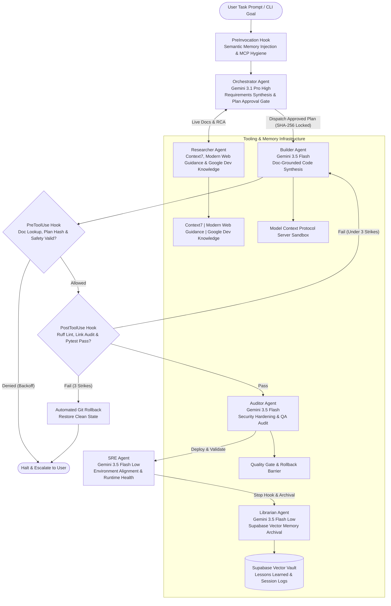

# Google Antigravity 2.0 Multi-Agent Python SDK

[](https://www.python.org/downloads/)
[](https://antigravity.google/docs)
[](https://google.github.io/agent-development-kit/)
[](https://cloud.google.com/vertex-ai)
[](tests/)
[](https://modelcontextprotocol.io/)
[](LICENSE)

A modular, terminal-based multi-agent Python SDK runtime built on **Google Antigravity 2.0** and the **Google Agent Development Kit (ADK)**.

Designed as an extensible foundation for multi-agent engineering workflows, the runtime coordinates specialized subagents to handle requirements synthesis, documentation-grounded code synthesis, security and QA audits, infrastructure health checks, and vector memory archival.

---

## System Architecture & Multi-Agent Flow

The orchestrator coordinates specialized subagents through an asynchronous event bus and structured handoff loop to maintain context isolation and enforce quality gates:



---

## Multi-Domain Engineering Applications

While the SDK includes a default software engineering team, its modular subagent topology maps cleanly to any technical problem domain:

| Domain / Use Case | Orchestrator & Planning | Execution & Synthesis | Validation & Archival |
| :--- | :--- | :--- | :--- |
| **Codebase Refactoring** *(Default)* | Architectural plan, dependency mapping | Modular code rewrites, AST validation | Security scan, regression test suite |
| **Automated Security & QA** | Vulnerability assessment plan | Patch generation, defensive sanitization | OWASP verification, audit log sync |
| **Cloud & DevOps / SRE** | Infrastructure drift detection | Terraform / Kubernetes generation | Dry-run validation, health telemetry |
| **Data Pipelines & ETL** | Schema mapping, pipeline design | SQLX / dbt model generation | Dataform dry-run, byte estimate audit |
| **API Integration & Webhooks** | OpenAPI schema contract analysis | Client adapter & handler creation | Idempotency checks, mock unit testing |

---

## Key Engineering Disciplines

### 1. Native SDK Lifecycle & Async Context Management
- Spawns agents using `google.antigravity.Agent` and `LocalAgentConfig` with role-scoped permission boundaries and hook policies (`@policy.pre_tool_call`).
- Includes a portable **4-Stage Lifecycle Hook Bundle** (`.agents/hooks.json`) executing across `PreInvocation`, `PreToolUse`, `PostToolUse`, and `Stop` events.

### 2. Structured Multi-Agent Handoffs & Plan Approval Gate
- Coordinates a 4-phase developer lifecycle across 6 personas: **Discovery & Grounding** (Librarian/Researcher) ➔ **Planning & RCA Gate** (Orchestrator) ➔ **Execution** (Builder) ➔ **Verification & Archival** (Auditor/SRE/Librarian).
- **SHA-256 Plan Immutability Fingerprinting**: Hashes the approved plan upon user sign-off and prompts for re-authorization if the plan is modified post-approval.

### 3. Proactive Documentation Grounding (`Context7` & `Modern Web Guidance`)
- Verifies that live documentation lookups occur before source code modifications via `safety_gate.py`:
  - **Context7 MCP** (`resolve-library-id`, `query-docs`) for third-party SDKs, frameworks, and packages.
  - **Google Modern Web Guidance** (`modern-web-guidance`) for modern HTML/CSS, Core Web Vitals, and browser standards.
  - **Google Developer Knowledge MCP** (`search_documents`, `get_documents`, `answer_query`) for Google Cloud, Gemini, ADK, Dialogflow CX, and Antigravity APIs.

### 4. Native Model Context Protocol (MCP) & Pluggable SaaS Adapters
- Connects to external tool servers defined in `mcp_config.json` (databases, CRMs, Git platforms, and cloud APIs), wrapping all invocations with runtime timeouts and defensive validation.
- Decoupled tool interface enables drop-in integration with any third-party SaaS without framework modifications.

### 5. Long-Term Vector Memory Archival
- Automatically retrieves relevant past lessons learned from Supabase during discovery and indexes resolution summaries at session completion.

---

## Repository Structure

```text
antigravity-sdk/
├── .agents/
│   ├── hooks.json             # 4-stage lifecycle hook registry (PreInvocation, PreToolUse, PostToolUse, Stop)
│   └── hooks/
│       ├── bundle_pre_invocation.py # MCP process cleanup & 384-dim semantic lesson loader
│       ├── safety_gate.py     # Loop guard, SHA-256 plan fingerprint & Doc Lookup Gate
│       ├── bundle_quality_gate.py   # Post-write Ruff formatter, link checker & pytest runner
│       └── bundle_teardown.py # SHA-256 deduplicated walkthrough archival to Supabase
├── agents/                    # Conversational playbooks & system prompts
│   ├── orchestrator.txt       # System architect & plan approval gatekeeper
│   ├── researcher.txt         # Diagnostic investigator (Context7, Modern Web Guidance, Google Dev Docs)
│   ├── builder.txt            # Lead software engineer
│   ├── auditor.txt            # QA & security compliance auditor
│   ├── sre.txt                # DevOps & environment reliability master
│   └── librarian.txt          # Memory archivist & technical writer
├── tests/                     # Offline unit test suite (27 tests)
│   ├── conftest.py            # Test configuration & SDK mock providers
│   ├── test_agent_prompts.py  # Prompt validation across all 6 personas
│   ├── test_mcp_config.py     # MCP Pydantic schemas & header injection
│   ├── test_orchestrator_mock.py # Dry-run execution & approval gates
│   └── test_policies.py       # Permission hooks, safety boundaries & lifecycle hook checks
├── native_orchestrator.py      # Native Antigravity 2.0 SDK execution engine
├── DASHBOARD.md               # Operational state & component dashboard
├── librarian.md               # Librarian persona & database schema guidelines
├── pyrightconfig.json         # Static type checker configuration
├── requirements.txt           # Python dependency specifications
├── pyproject.toml             # Pytest configuration & package metadata
├── .env.template              # Environment variable template
└── README.md
```

---

## Quick Start & Execution

### 1. Clone & Setup Virtual Environment
```bash
git clone https://github.com/dnguyen029/antigravity-sdk.git
cd antigravity-sdk

python3 -m venv .venv
source .venv/bin/activate
pip install -r requirements.txt
```

### 2. Run Offline Unit Tests (No Cloud Credentials Required)
Execute the complete test suite locally:

```bash
pytest -v
```

```text
============================= test session starts ==============================
tests/test_agent_prompts.py .......                                      [ 25%]
tests/test_mcp_config.py ........                                        [ 55%]
tests/test_orchestrator_mock.py ......                                   [ 77%]
tests/test_policies.py ......                                            [100%]
============================== 27 passed in 0.24s ==============================
```

### 3. Simulated Dry-Run (No Cloud Credentials Required)
Evaluate the multi-agent orchestration sequence locally without API spend:

```bash
python native_orchestrator.py "Refactor database connection pool" --mock
```

### 4. Live Multi-Agent Execution (Vertex AI + Gemini)
Configure your environment variables in `.env`:

```bash
cp .env.template .env
```

Run the multi-agent orchestrator:

```bash
python native_orchestrator.py "Implement rate limiting middleware on API endpoints"
```

---

## Configuration & Environment Variables

| Environment Variable | Description | Scope / Notes |
| :--- | :--- | :--- |
| `PROJECT_ID` | GCP Project ID hosting Vertex AI Gemini models | Required for live agent inference |
| `GOOGLE_CLOUD_LOCATION` | Vertex AI regional endpoint (e.g., `us-central1`) | Defaults to `us-central1` |
| `GOOGLE_GENAI_USE_VERTEXAI` | Enables Vertex AI backend (`True`) | Set to `True` for Vertex AI |
| `SUPABASE_URL` | Supabase project REST API endpoint | Required for long-term memory vault |
| `SUPABASE_ACCESS_TOKEN` | Service role / API key for Supabase memory bank | Required for memory queries |
| `EXA_API_KEY` | Exa search API key for external web research | Optional |

---

## Ecosystem & Related Repositories

* **[receptionist-template](https://github.com/dnguyen029/receptionist-template)** — Production multi-agent conversational voice receptionist application built on the Google ADK and Vertex AI.
* **[antigravity-portfolio](https://github.com/dnguyen029/antigravity-portfolio)** — Technical operations portfolio showcasing end-to-end multi-agent governance and architecture.

### Live Next.js Web Applications

| Application | Live URL | Overview |
| :--- | :--- | :--- |
| **David Nguyen — Portfolio** | [david-nguyen-bay.vercel.app](https://david-nguyen-bay.vercel.app/) | Interactive Next.js portfolio highlighting AI systems engineering, headless commerce, and multi-agent architecture. |
| **Sports Matrix Analytics** | [dashboard-five-tan-52.vercel.app](https://dashboard-five-tan-52.vercel.app/) | Real-time sports analytics and market line-movement dashboard powered by Next.js App Router, Supabase, and Cloud Run. |
| **Multi-Agent Agency Platform** | [swarm-agency.vercel.app](https://swarm-agency.vercel.app/) | Next.js web platform showcasing governed multi-agent development workflows and automation capabilities. |

---

## License
This project is licensed under the MIT License — see the [LICENSE](LICENSE) file for details.
